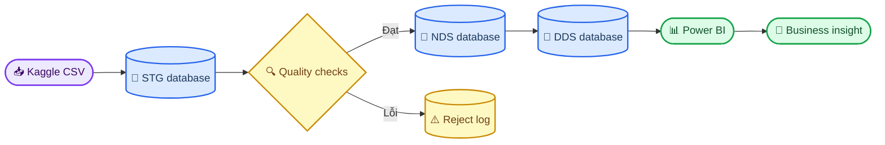

# Home Credit Risk & Loan Portfolio Analytics

_Đồ án môn Hệ thống thông tin phục vụ trí tuệ kinh doanh — Nhóm 8_

---

## 📋 Tổng quan

Đồ án xây dựng một hệ thống BI cho lĩnh vực fintech từ bộ dữ liệu **Home Credit Default Risk**. Trọng tâm là thiết kế kho dữ liệu, triển khai ETL bằng SSIS và xây dashboard hỗ trợ phân tích hồ sơ vay, lịch sử tín dụng, hành vi thanh toán và rủi ro không trả được nợ.

> 📌 **Định hướng:** Đây là đồ án BI/DW, không phải bài thi Kaggle thuần machine learning. Mô hình dự đoán chỉ là phần mở rộng sau khi hoàn thành kho dữ liệu và dashboard.

## 👥 Thành viên Nhóm 8

| MSSV | Họ và tên | Vai trò chính |
| ---: | --- | --- |
| 22127107 | Nguyễn Thế Hiển | Mac: data intake, profiling/DQ, modeling source, KPI baseline, tài liệu và điều phối |
| 23127182 | Nguyễn Trường Duy | Windows: toolchain, SSIS staging, reject flow và rerun test |
| 23127192 | Nguyễn Văn Hộp | Windows: SSIS NDS/DDS, SQL runtime, KPI reconciliation và performance |
| 23127328 | Nguyễn Quốc Bảo | Windows: Power BI, SQL–DAX validation, evidence và gói trình bày |

Mỗi thành viên có một đầu việc chính và một đầu việc review chéo; trạng thái và đầu việc bàn giao được theo dõi trong [project status](docs/PROJECT_STATUS.md) và [submission checklist](docs/SUBMISSION_CHECKLIST.md).

## 🎯 Sản phẩm bàn giao

- Cơ sở dữ liệu `STG`, `NDS` và `DDS` trên SQL Server
- SSIS packages cho luồng extract, clean, transform và load
- Script tạo bảng, khóa, chỉ mục và truy vấn kiểm thử
- Power BI dashboard gồm Executive, Credit Risk, Payment Behavior và Data Quality
- Báo cáo đồ án, data dictionary, source-to-target mapping và slide thuyết trình
- Nhật ký kiểm thử và bằng chứng đối soát dữ liệu

## 🏗️ Kiến trúc dự kiến



## 🚀 Trình tự thực hiện

1. Chốt câu hỏi nghiệp vụ, KPI và phạm vi dữ liệu
2. Tải dữ liệu, kiểm kê file và lập báo cáo data profiling
3. Thiết kế staging và NDS, xác định khóa và quan hệ
4. Thiết kế DDS theo grain, fact và dimension
5. Xây SSIS packages và cơ chế ghi log/reject
6. Đối soát số dòng, khóa, null và KPI giữa các tầng
7. Kết nối Power BI, xây dashboard và kiểm thử bộ lọc
8. Hoàn thiện báo cáo, slide và kịch bản demo

## ▶️ Quick start trên máy Windows tích hợp

1. Hoàn thành [checklist công cụ](docs/WINDOWS_SETUP_CHECKLIST.md).
2. Deploy toàn bộ SQL object bằng `scripts/Deploy-HomeCreditSql.ps1` hoặc `sql/000_deploy_all.sql` trong SQLCMD mode.
3. Dựng và chạy SSIS theo [package build specification](ssis/PACKAGE_BUILD_SPEC.md).
4. Yêu cầu staging, NDS và DDS validators không có `FAIL`.
5. Chạy `sql/06_analytics/061_kpi_reconciliation.sql` và lưu evidence.
6. Dựng Power BI theo [model specification](powerbi/MODEL_SPEC.md) và [canonical DAX](powerbi/MEASURES_DAX.md).

Trạng thái chi tiết và phần chưa thể chạy trên macOS nằm trong [project status](docs/PROJECT_STATUS.md).

Kiểm tra lại toàn bộ artifact local trước khi chuyển máy:

```bash
python3 scripts/validate_kpi_baseline.py
python3 scripts/validate_project_artifacts.py
```

## 📚 Tài liệu trong repository

| Tài liệu | Mục đích |
| --- | --- |
| [Data intake guide](docs/DATA_DOWNLOAD_AND_INTAKE.md) | Tải, đặt và kiểm tra bộ dữ liệu Kaggle |
| [Data profile report](docs/DATA_PROFILE_REPORT.md) | Inventory, missingness, key integrity và quyết định modeling |
| [Data cleaning rules](docs/DATA_CLEANING_RULES.md) | Rule catalog, action và acceptance criteria STG → NDS |
| [Project status](docs/PROJECT_STATUS.md) | Tiến độ thực tế, phần đã làm và backlog theo phase |
| [Raw data SHA-256](docs/RAW_DATA_SHA256.txt) | Manifest kiểm tra CSV gốc không bị thay đổi |
| [DDS model](docs/DDS_MODEL.md) | Bus matrix, grain, additive behavior và unknown-member policy |
| [Source-to-target mapping](docs/SOURCE_TO_TARGET_MAPPING.md) | Mapping và transformations xuyên suốt các tầng |
| [KPI dictionary](docs/KPI_DICTIONARY.md) | Định nghĩa chính thức, population và filter rules |
| [Full-data KPI baseline](docs/KPI_BASELINE_FULL_SCAN.md) | Kết quả KPI và insight từ full scan 58,4 triệu dòng |
| [Test plan](docs/TEST_PLAN.md) | 22 test cases, kết quả local và yêu cầu evidence runtime |
| [Data dictionary](docs/DATA_DICTIONARY.md) | Grain, keys, common columns và derived fields |
| [Windows setup checklist](docs/WINDOWS_SETUP_CHECKLIST.md) | Cài và xác nhận SQL Server, SSDT, SSIS và Power BI |
| [Submission checklist](docs/SUBMISSION_CHECKLIST.md) | Checklist bàn giao, evidence và ownership cho 4 thành viên |
| [Data workspace](data/README.md) | Quy tắc đặt dữ liệu và kiểm kê nguồn |
| [SQL workspace](sql/README.md) | Thứ tự script và quy ước SQL |
| [SSIS workspace](ssis/README.md) | Cấu trúc packages và logging |
| [Power BI workspace](powerbi/README.md) | Trang dashboard, KPI và quy ước mô hình |

## 🔗 Nguồn dữ liệu

Bộ dữ liệu gồm các hồ sơ vay hiện tại, khoản vay trước, dữ liệu credit bureau, lịch sử trả góp và số dư theo tháng.[^1]

[^1]: Home Credit Group. (2018). "Home Credit Default Risk — Data." _Kaggle_. https://www.kaggle.com/competitions/home-credit-default-risk/data
