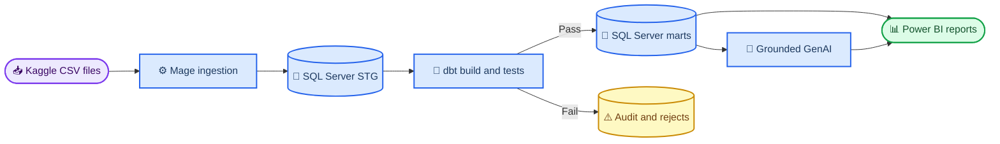

# Home Credit Risk & Loan Portfolio Analytics

_An academic Business Intelligence and data warehousing project by Group 8_

[](https://github.com/TheHien04/Home-Credit/actions/workflows/validate.yml)

---

## 📋 Overview

This repository implements a reproducible BI pipeline for consumer-credit portfolio and default-risk analysis using the Home Credit Default Risk dataset.[^1] The required stack is Mage.ai, dbt, SQL Server, Power BI, and a grounded generative-AI component.

The repository is intentionally **code-first**: Mage orchestration specifications, dbt models and tests, SQL, Python validation utilities, Power BI model specifications, and technical documentation are versioned here. Raw Kaggle data, generated reports, runtime screenshots, credentials, and binary BI artifacts are excluded from Git.

> 📌 **Scope:** This is a BI/data warehouse project, not a production credit-decision system or a Kaggle machine-learning submission.

## 🎯 Project scope

| Area | Deliverable | Current state |
| --- | --- | --- |
| Data intake | Source inventory, SHA-256 manifest, profiling scripts | Ready |
| Data quality | Cleaning contract, anomaly flags, reject handling | Ready for runtime validation |
| SQL warehouse | Control, STG, NDS, DDS, tests, analytics views | Existing SQL assets ready for migration/runtime validation |
| Mage.ai | Ingestion and orchestration pipeline | Build specification ready; runtime pipeline pending |
| dbt | SQL Server MVP model, tests, and lineage | Application vertical slice implemented; history migration pending |
| Power BI | Semantic model, canonical DAX, five-page dashboard design | Specification complete; PBIX pending |
| Generative AI | Grounded KPI narrative contract and JSON schema | Contract ready; provider integration pending |
| Verification | Versioned KPI baseline, artifact validator, GitHub Actions | Local checks pass; CI enabled |

## 🏗️ Architecture



Mage orchestrates ingestion and dbt runs; dbt performs deterministic transformation and testing in SQL Server; Power BI consumes verified marts. Mage supports dbt scheduling, dependency execution, tests, and monitoring when run in Docker or Mage Pro.[^2] SQL Server connectivity is available through Mage's MSSQL integration.[^3]

The SQL Server dbt adapter is community-maintained, so the team must record and freeze the validated adapter, dbt Core, ODBC, and SQL Server versions after the connection proof passes.[^4]

## 📊 Verified data baseline

The local full-file scan produced the following independent reconciliation targets. These values are expected results for later SQL Server and Power BI validation, not substitutes for Windows runtime evidence.

| Metric | Verified value |
| --- | ---: |
| Source files | 10 |
| Total source rows | 58,538,856 |
| Business rows scanned | 58,441,149 |
| Labeled applications | 307,511 |
| Default applications | 24,825 |
| Default rate | 8.0729% |
| Previous-application approval rate | 62.6794% |
| Late-payment row rate | 8.5739% |

See the [full KPI baseline](docs/KPI_BASELINE_FULL_SCAN.md) and [data profile report](docs/DATA_PROFILE_REPORT.md) for populations, assumptions, and quality findings.

## 🚀 Quick start

### Prerequisites

| Requirement | Purpose | Platform |
| --- | --- | --- |
| Python 3 | Profiling and validation | macOS, Windows, or Linux |
| Docker Desktop | Mage OSS and Mage–dbt integration | macOS, Windows, or Linux |
| Mage.ai | Ingestion and orchestration | Docker |
| dbt Core with `dbt-sqlserver` | Transformation, tests, and lineage | Mage container or local development |
| SQL Server and `sqlcmd` | Persistence, deployment, and testing | Canonical integration host |
| Power BI Desktop | Semantic model and dashboard | Windows |

### Clone and prepare the data

```bash
git clone https://github.com/TheHien04/Home-Credit.git
cd Home-Credit
```

Download the competition archive after accepting the Kaggle rules, then extract the ten source files into:

```text
Home-Credit/
└── home-credit-default-risk/
    ├── application_train.csv
    ├── application_test.csv
    ├── previous_application.csv
    └── ...
```

Raw data is ignored by Git. Do not rename, edit, or recommit the CSV files.

### Run local validation

```bash
python3 scripts/check_home_credit_data.py --root home-credit-default-risk --count-rows
shasum -a 256 -c docs/RAW_DATA_SHA256.txt
python3 scripts/validate_kpi_baseline.py
python3 scripts/validate_project_artifacts.py
```

The final two commands must report `PASS`. The artifact validator checks raw-file hashes, internal Markdown links, SQL structure, expected object counts, and optional local report sources. GitHub Actions runs the same code-first checks with `--skip-raw` because the Kaggle files are intentionally excluded from the repository.

### Deploy on the Windows integration host

```powershell
powershell -ExecutionPolicy Bypass -File .\scripts\Deploy-HomeCreditSql.ps1 `
  -ServerInstance "localhost"
```

The deployment creates the control, STG, NDS, DDS, validation, and analytics objects, then runs the schema smoke test. Existing SQL loaders remain as reconciliation references while transformation ownership migrates to dbt.

### Run the required Mage and dbt vertical slice

1. Follow the [toolchain setup](docs/TOOLCHAIN_SETUP.md).
2. Configure the canonical SQL Server connection from `mage/io_config.yaml.example` without committing credentials.
3. Build the application ingestion pipeline from the [Mage specification](mage/README.md).
4. Run the [dbt MVP](dbt_home_credit/README.md) with the `BatchID` returned by Mage.
5. Compare the dbt mart with the versioned KPI baseline before connecting Power BI.

## 📁 Repository structure

| Path | Purpose |
| --- | --- |
| `scripts/` | Data checks, profiling, KPI computation, and deployment utilities |
| `sql/` | Ordered SQL Server deployment, ETL, validation, and analytics scripts |
| `mage/` | Required orchestration design and safe SQL Server configuration template |
| `dbt_home_credit/` | Required dbt models, tests, profile template, and lineage source |
| `powerbi/` | Semantic-model specification, DAX measures, and future evidence |
| `genai/` | Grounded KPI narrative contract and structured-output schema |
| `docs/` | Data, modeling, KPI, testing, setup, and handoff documentation |
| `data/` | Ignored local workspace; only the aggregate KPI baseline is versioned |

## 👥 Team

| Student ID | Member | Primary responsibility |
| ---: | --- | --- |
| 22127107 | Nguyễn Thế Hiển | Data intake, profiling, quality rules, KPI baseline, documentation, coordination |
| 23127182 | Nguyễn Trường Duy | Mage ingestion, orchestration, reject flow, rerun evidence |
| 23127192 | Nguyễn Văn Hộp | dbt models/tests, SQL Server deployment, KPI reconciliation, performance |
| 23127328 | Nguyễn Quốc Bảo | Power BI, grounded GenAI integration, SQL-to-DAX reconciliation, demo |

## 📚 Documentation

| Document | Purpose |
| --- | --- |
| [Data download and intake](docs/DATA_DOWNLOAD_AND_INTAKE.md) | Dataset placement, file inventory, and source-data rules |
| [Data profile report](docs/DATA_PROFILE_REPORT.md) | Shapes, missingness, key integrity, and relationship coverage |
| [Data cleaning rules](docs/DATA_CLEANING_RULES.md) | Deterministic STG-to-NDS transformations and acceptance criteria |
| [Data dictionary](docs/DATA_DICTIONARY.md) | Curated tables, grains, keys, and derived fields |
| [DDS model](docs/DDS_MODEL.md) | Bus matrix, fact grains, dimensions, and additive behavior |
| [Source-to-target mapping](docs/SOURCE_TO_TARGET_MAPPING.md) | Representative mappings across warehouse layers |
| [KPI dictionary](docs/KPI_DICTIONARY.md) | Canonical formulas, populations, and filter rules |
| [Full-data KPI baseline](docs/KPI_BASELINE_FULL_SCAN.md) | Independent expected values from the complete local scan |
| [Test plan](docs/TEST_PLAN.md) | Validation catalog, execution order, and evidence requirements |
| [Required toolchain setup](docs/TOOLCHAIN_SETUP.md) | Mage, dbt, SQL Server, Power BI, and GenAI setup |
| [Project status](docs/PROJECT_STATUS.md) | Completed work, pending runtime gates, and next actions |
| [Submission checklist](docs/SUBMISSION_CHECKLIST.md) | Ownership, evidence, and final-package requirements |
| [SQL workspace](sql/README.md) | Deployment order and post-staging execution commands |

## ⚠️ Current limitations

- Mage, dbt, SQL Server, Power BI, and GenAI have not yet been executed end to end on the canonical host
- Runtime screenshots, row-throughput measurements, transaction-log usage, and rerun evidence remain pending
- The dbt MVP currently covers the application vertical slice; all history sources still require migration
- `.pbix`, PDF, and LaTeX report sources are intentionally excluded from this code-first release
- Segment-level findings are descriptive associations and must not be interpreted as causal effects

## 🔐 Data and security

- Keep raw Kaggle files outside version control
- Never commit `kaggle.json`, credentials, access tokens, or private connection strings
- Preserve the original files and verify them against `docs/RAW_DATA_SHA256.txt`
- Store generated evidence only after checking that screenshots contain no secrets

## 🔗 Reference

[^1]: Home Credit Group. (2018). "Home Credit Default Risk — Data." _Kaggle_. https://www.kaggle.com/competitions/home-credit-default-risk/data

[^2]: Mage AI. "Use dbt with Mage." https://docs.mage.ai/guides/dbt/overview

[^3]: Mage AI. "Microsoft SQL Server." https://docs.mage.ai/integrations/databases/MicrosoftSQLServer

[^4]: dbt Labs. "Connect Microsoft SQL Server to dbt." https://docs.getdbt.com/docs/local/connect-data-platform/mssql-setup
