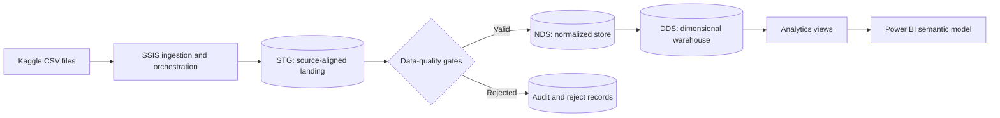

# Home Credit Risk & Loan Portfolio Analytics

An academic Business Intelligence system for analyzing consumer-loan portfolios, repayment behavior, and credit risk with SSIS, SQL Server, and Power BI.

[](https://github.com/TheHien04/Home-Credit/actions/workflows/validate.yml)

## Overview

This project turns the Home Credit Default Risk dataset into a governed analytical warehouse. It addresses the full BI lifecycle: source intake, data profiling, quality controls, ETL orchestration, normalized storage, dimensional modeling, KPI reconciliation, and dashboard design.

The system is designed for portfolio monitoring and descriptive risk analysis. It is **not** a production credit-decision engine, a causal study, or a Kaggle machine-learning submission.

### Business questions

- How large is the labeled application portfolio, and what is its observed default rate?
- How does default rate vary across contract, age, income, and affordability segments?
- What are the previous-application approval and recorded late-payment rates?
- How should missing parents, source sentinels, and one-to-many histories be handled without distorting KPIs?

## Architecture



The warehouse deliberately separates three responsibilities:

- **STG** preserves source-aligned values and load lineage.
- **NDS** applies deterministic normalization while retaining quality flags.
- **DDS** exposes conformed dimensions and facts at explicit grains for BI reporting.

This separation prevents one-to-many history tables from multiplying application rows and corrupting application-level measures.

## Current delivery status

_Status as of 29 October 2026_

| Workstream | Delivered | Verification state |
| --- | --- | --- |
| Source intake | Ten-file inventory, SHA-256 manifest, intake rules | Local full-data verification passed |
| Profiling and quality | Full scans, anomaly counts, cleaning contract | Local full-data verification passed |
| SQL Server warehouse | Control, STG, NDS, DDS, ETL, tests, analytics views | Source implemented; Windows runtime pending |
| SSIS | Five-package build specification and application-train staging project | Initial source committed; parameterization and execution pending |
| KPI governance | KPI dictionary and independent full-file baseline | Local reconciliation passed |
| Power BI | Semantic-model and canonical DAX specifications | PBIX and visual validation pending |
| Project validation | Python validators and GitHub Actions | Passing |

`IMPLEMENTED` and `VERIFIED` are intentionally different states. SQL Server, SSIS, and Power BI are not considered runtime-verified until their outputs are captured from the canonical Windows environment.

## Verified baseline

The independent local scan provides reconciliation targets for later SQL Server and Power BI execution.

| Metric | Verified value |
| --- | ---: |
| Source files | 10 |
| Total source rows | 58,538,856 |
| Business rows scanned | 58,441,149 |
| Labeled applications | 307,511 |
| Default applications | 24,825 |
| Observed default rate | 8.0729% |
| Previous-application approval rate | 62.6794% |
| Recorded late-payment row rate | 8.5739% |

These figures are test oracles, not substitutes for database execution evidence. Their populations and formulas are documented in the [KPI baseline](docs/KPI_BASELINE_FULL_SCAN.md) and [KPI dictionary](docs/KPI_DICTIONARY.md).

### Selected quality findings

| Finding | Rows | Warehouse treatment |
| --- | ---: | --- |
| `DAYS_EMPLOYED = 365243` | 55,374 | Convert normalized tenure to null and retain a flag |
| Gender category `XNA` | 4 | Map to Unknown at NDS and retain a flag |
| Previous-date sentinels | 997,144 | Convert affected normalized dates to null and retain flags |
| Non-positive previous payment count | 144,985 | Preserve source value and flag for review |
| Negative bureau debt | 8,418 | Preserve value to avoid silent distortion and flag it |
| Missing installment payment value/date | 2,905 | Preserve null and set `PaymentRecordedFlag = 0` |

Raw CSV files are never modified. Cleaning occurs through deterministic NDS rules with lineage and quality indicators.

## Repository layout

```text
Home-Credit/
├── .github/workflows/       # Continuous validation
├── data/                    # Ignored local workspace and safe aggregate baseline
├── docs/                    # Modeling, quality, KPI, testing, and handoff documents
├── powerbi/                 # Semantic-model and DAX specifications
├── scripts/                 # Profiling, validation, sampling, and deployment utilities
├── sql/                     # Ordered SQL Server warehouse and test scripts
└── ssis/                    # SSIS specification and Visual Studio project source
```

Raw Kaggle data, credentials, PBIX binaries, generated reports, and runtime screenshots are intentionally excluded from this code-first repository.

## Getting started

### 1. Prerequisites

| Tool | Purpose | Platform |
| --- | --- | --- |
| Python 3 | Profiling and repository validation | macOS, Windows, or Linux |
| SQL Server and `sqlcmd` | Warehouse deployment and SQL testing | Windows integration host |
| Visual Studio with SSDT/SSIS | ETL package development and execution | Windows |
| Power BI Desktop | Semantic model and dashboard | Windows |

Follow the [Windows setup checklist](docs/WINDOWS_SETUP_CHECKLIST.md) before attempting runtime integration.

### 2. Clone the repository

```bash
git clone https://github.com/TheHien04/Home-Credit.git
cd Home-Credit
```

### 3. Prepare the dataset

Accept the competition rules and download the dataset from [Kaggle](https://www.kaggle.com/competitions/home-credit-default-risk/data). Extract the files without renaming or editing them:

```text
Home-Credit/
└── home-credit-default-risk/
    ├── application_train.csv
    ├── application_test.csv
    ├── bureau.csv
    ├── bureau_balance.csv
    ├── previous_application.csv
    └── ...
```

The folder is ignored by Git. Verify every source file against [the SHA-256 manifest](docs/RAW_DATA_SHA256.txt).

### 4. Run local acceptance checks

```bash
python3 scripts/check_home_credit_data.py \
  --root home-credit-default-risk \
  --count-rows

shasum -a 256 -c docs/RAW_DATA_SHA256.txt
python3 scripts/validate_kpi_baseline.py
python3 scripts/validate_project_artifacts.py
```

The final two commands must report `PASS`. GitHub Actions performs the code-first subset with `--skip-raw` because competition data is not stored in the repository.

### 5. Deploy the SQL Server objects

On the Windows integration host:

```powershell
powershell -ExecutionPolicy Bypass `
  -File .\scripts\Deploy-HomeCreditSql.ps1 `
  -ServerInstance "localhost"
```

The script verifies raw-file hashes, deploys the database objects in dependency order, and runs the schema smoke test. The expected deployment contains **59 required objects**.

See [SQL workspace guidance](sql/README.md) for the deployment order and post-staging commands.

### 6. Execute and validate the SSIS load

1. Open `ssis/HomeCredit_BI/HomeCredit_ETL/HomeCredit_ETL.dtproj` in Visual Studio.
2. Replace machine-specific file paths and SQL connections with reviewed project parameters.
3. Run the bounded TRAIN/TEST application sample before the full load.
4. Record the Git commit and one canonical `BatchID`.
5. Execute `sql/05_tests/055_validate_application_sample.sql`.
6. Continue with STG, NDS, DDS, and KPI validators only after the sample passes.

The expected sample counts, mapping contract, and presentation handoff are consolidated in the [30 October progress review](docs/PROGRESS_REVIEW_30OCT.md).

## Validation strategy

Every release is checked at multiple levels:

| Layer | Key checks |
| --- | --- |
| Source | SHA-256, schema, row count, mandatory keys |
| STG | Split rules, target domain, key uniqueness, source parity |
| NDS | Sentinel conversion, flags, parent coverage, population reconciliation |
| DDS | Declared grain, surrogate-key lookup, fact/dimension parity |
| KPI | Numerator, denominator, population, SQL-to-DAX reconciliation |
| Rerun | Stable counts, no unintended duplicates, auditable batch lifecycle |

Runtime evidence must use the same commit and `BatchID`. A source file, specification, expected value, or mockup alone is not evidence that a Windows runtime gate passed.

## Core documentation

| Document | Purpose |
| --- | --- |
| [Data profile](docs/DATA_PROFILE_REPORT.md) | Source shapes, missingness, keys, anomalies, and parent coverage |
| [Cleaning rules](docs/DATA_CLEANING_RULES.md) | Deterministic STG-to-NDS transformations |
| [Data dictionary](docs/DATA_DICTIONARY.md) | Curated tables, grains, keys, and derived fields |
| [DDS model](docs/DDS_MODEL.md) | Bus matrix, detailed star schema, PK/FK relationships, and additivity |
| [Source-to-target mapping](docs/SOURCE_TO_TARGET_MAPPING.md) | Representative mappings across warehouse layers |
| [Test plan](docs/TEST_PLAN.md) | Acceptance catalog, execution order, and evidence requirements |
| [Project status](docs/PROJECT_STATUS.md) | Completed work, runtime gaps, and next actions |
| [Submission checklist](docs/SUBMISSION_CHECKLIST.md) | Ownership and final-package gates |

## Team

| Student ID | Member | Primary ownership |
| ---: | --- | --- |
| 22127107 | Nguyễn Thế Hiển | Data intake, profiling, quality rules, KPI baseline, documentation, coordination |
| 23127182 | Nguyễn Trường Duy | Windows toolchain, SSIS staging, reject flow, rerun validation |
| 23127192 | Nguyễn Văn Hộp | SQL deployment, NDS/DDS integration, KPI reconciliation, performance evidence |
| 23127328 | Nguyễn Quốc Bảo | Power BI, SQL-to-DAX reconciliation, runtime evidence, presentation package |

## Known limitations

- End-to-end SQL Server, SSIS, and Power BI execution is still pending on the canonical Windows host.
- The committed SSIS project currently represents the initial application-train staging implementation, not the complete five-package pipeline.
- Runtime screenshots, throughput, transaction-log growth, rerun evidence, and the final PBIX are not yet available.
- The source is anonymized and does not provide original calendar dates or a documented currency label.
- Segment comparisons are descriptive associations and must not be interpreted as causal effects.

## Data governance

- Do not commit raw Kaggle CSV files or row-level extracts.
- Never commit `kaggle.json`, passwords, tokens, private connection strings, certificates, or local environment files.
- Preserve source files unchanged and verify their hashes before every canonical load.
- Inspect screenshots and logs for credentials or machine-specific information before publishing evidence.
- Keep rejected rows and unmatched histories auditable; do not silently discard inconvenient records.

## Reference

Home Credit Group. (2018). _Home Credit Default Risk — Data_. Kaggle. https://www.kaggle.com/competitions/home-credit-default-risk/data
