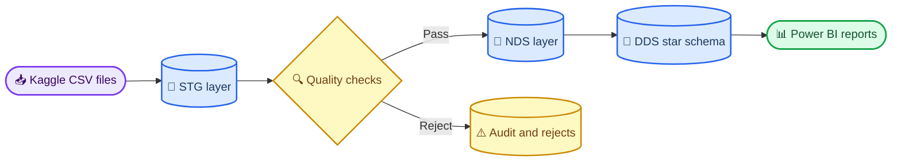

# Home Credit Risk & Loan Portfolio Analytics

_An academic Business Intelligence and data warehousing project by Group 8_

---

## 📋 Overview

This repository implements a reproducible BI pipeline for consumer-credit portfolio and default-risk analysis using the Home Credit Default Risk dataset.[^1] The project focuses on dimensional modeling, ETL controls, data quality, KPI reconciliation, and Power BI reporting.

The repository is intentionally **code-first**: SQL, Python validation utilities, SSIS build specifications, Power BI model specifications, and technical documentation are versioned here. Raw Kaggle data, generated reports, runtime screenshots, and binary BI artifacts are excluded from Git.

> 📌 **Scope:** This is a BI/data warehouse project, not a production credit-decision system or a Kaggle machine-learning submission.

## 🎯 Project scope

| Area | Deliverable | Current state |
| --- | --- | --- |
| Data intake | Source inventory, SHA-256 manifest, profiling scripts | Ready |
| Data quality | Cleaning contract, anomaly flags, reject handling | Ready for runtime validation |
| SQL warehouse | Control, STG, NDS, DDS, ETL, tests, analytics views | Implemented; Windows execution pending |
| SSIS | Five-package control-flow and data-flow specification | Specification complete; packages pending |
| Power BI | Semantic model, canonical DAX, five-page dashboard design | Specification complete; PBIX pending |
| Verification | Full-file KPI baseline and artifact validator | Local checks pass |

## 🏗️ Architecture



The warehouse separates source-aligned staging, deterministic normalization, and dimensional presentation. Each fact table retains an explicit grain so that one-to-many history tables do not inflate application-level KPIs.

## 📊 Verified data baseline

The local full-file scan produced the following independent reconciliation targets. These values are expected results for later SQL Server and Power BI validation, not substitutes for Windows runtime evidence.

| Metric | Verified value |
| --- | ---: |
| Source files | 10 |
| Total source rows | 58,538,856 |
| Business rows scanned | 58,441,149 |
| Labeled applications | 307,511 |
| Default applications | 24,825 |
| Default rate | 8.0729% |
| Previous-application approval rate | 62.6794% |
| Late-payment row rate | 8.5739% |

See the [full KPI baseline](docs/KPI_BASELINE_FULL_SCAN.md) and [data profile report](docs/DATA_PROFILE_REPORT.md) for populations, assumptions, and quality findings.

## 🚀 Quick start

### Prerequisites

| Requirement | Purpose | Platform |
| --- | --- | --- |
| Python 3 | Profiling and validation | macOS, Windows, or Linux |
| SQL Server and `sqlcmd` | Warehouse deployment and testing | Windows integration host |
| Visual Studio with SSDT/SSIS | SSIS package implementation | Windows |
| Power BI Desktop | Semantic model and dashboard | Windows |

### Clone and prepare the data

```bash
git clone https://github.com/TheHien04/Home-Credit.git
cd Home-Credit
```

Download the competition archive after accepting the Kaggle rules, then extract the ten source files into:

```text
Home-Credit/
└── home-credit-default-risk/
    ├── application_train.csv
    ├── application_test.csv
    ├── previous_application.csv
    └── ...
```

Raw data is ignored by Git. Do not rename, edit, or recommit the CSV files.

### Run local validation

```bash
python3 scripts/check_home_credit_data.py --root home-credit-default-risk --count-rows
shasum -a 256 -c docs/RAW_DATA_SHA256.txt
python3 scripts/validate_kpi_baseline.py
python3 scripts/validate_project_artifacts.py
```

The final two commands must report `PASS`. The artifact validator also checks raw-file hashes, internal Markdown links, SQL structure, expected object counts, and optional local report sources.

### Deploy on the Windows integration host

```powershell
powershell -ExecutionPolicy Bypass -File .\scripts\Deploy-HomeCreditSql.ps1 `
  -ServerInstance "localhost"
```

The deployment creates the control, STG, NDS, DDS, ETL, validation, and analytics objects, then runs the schema smoke test. Continue with the [SSIS package build specification](ssis/PACKAGE_BUILD_SPEC.md), [Power BI model specification](powerbi/MODEL_SPEC.md), and [canonical DAX measures](powerbi/MEASURES_DAX.md).

## 📁 Repository structure

| Path | Purpose |
| --- | --- |
| `scripts/` | Data checks, profiling, KPI computation, and deployment utilities |
| `sql/` | Ordered SQL Server deployment, ETL, validation, and analytics scripts |
| `ssis/` | SSIS package build specification and future runtime artifacts |
| `powerbi/` | Semantic-model specification, DAX measures, and future evidence |
| `docs/` | Data, modeling, KPI, testing, setup, and handoff documentation |
| `data/` | Ignored local workspace for generated or intermediate data |

## 👥 Team

| Student ID | Member | Primary responsibility |
| ---: | --- | --- |
| 22127107 | Nguyễn Thế Hiển | Data intake, profiling, quality rules, KPI baseline, documentation, coordination |
| 23127182 | Nguyễn Trường Duy | Windows toolchain, SSIS staging, reject flow, rerun validation |
| 23127192 | Nguyễn Văn Hộp | SQL deployment, NDS/DDS packages, KPI reconciliation, performance evidence |
| 23127328 | Nguyễn Quốc Bảo | Power BI, SQL-to-DAX reconciliation, runtime evidence, presentation package |

## 📚 Documentation

| Document | Purpose |
| --- | --- |
| [Data download and intake](docs/DATA_DOWNLOAD_AND_INTAKE.md) | Dataset placement, file inventory, and source-data rules |
| [Data profile report](docs/DATA_PROFILE_REPORT.md) | Shapes, missingness, key integrity, and relationship coverage |
| [Data cleaning rules](docs/DATA_CLEANING_RULES.md) | Deterministic STG-to-NDS transformations and acceptance criteria |
| [Data dictionary](docs/DATA_DICTIONARY.md) | Curated tables, grains, keys, and derived fields |
| [DDS model](docs/DDS_MODEL.md) | Bus matrix, fact grains, dimensions, and additive behavior |
| [Source-to-target mapping](docs/SOURCE_TO_TARGET_MAPPING.md) | Representative mappings across warehouse layers |
| [KPI dictionary](docs/KPI_DICTIONARY.md) | Canonical formulas, populations, and filter rules |
| [Full-data KPI baseline](docs/KPI_BASELINE_FULL_SCAN.md) | Independent expected values from the complete local scan |
| [Test plan](docs/TEST_PLAN.md) | Validation catalog, execution order, and evidence requirements |
| [Windows setup checklist](docs/WINDOWS_SETUP_CHECKLIST.md) | SQL Server, Visual Studio, SSDT/SSIS, and Power BI setup |
| [Project status](docs/PROJECT_STATUS.md) | Completed work, pending runtime gates, and next actions |
| [Submission checklist](docs/SUBMISSION_CHECKLIST.md) | Ownership, evidence, and final-package requirements |
| [SQL workspace](sql/README.md) | Deployment order and post-staging execution commands |

## ⚠️ Current limitations

- SQL Server, SSIS, and Power BI have not yet been executed end to end on the canonical Windows host
- Runtime screenshots, row-throughput measurements, transaction-log usage, and rerun evidence remain pending
- `.dtsx`, `.pbix`, PDF, and LaTeX report sources are intentionally excluded from this code-first release
- Segment-level findings are descriptive associations and must not be interpreted as causal effects

## 🔐 Data and security

- Keep raw Kaggle files outside version control
- Never commit `kaggle.json`, credentials, access tokens, or private connection strings
- Preserve the original files and verify them against `docs/RAW_DATA_SHA256.txt`
- Store generated evidence only after checking that screenshots contain no secrets

## 🔗 Reference

[^1]: Home Credit Group. (2018). "Home Credit Default Risk — Data." _Kaggle_. https://www.kaggle.com/competitions/home-credit-default-risk/data
