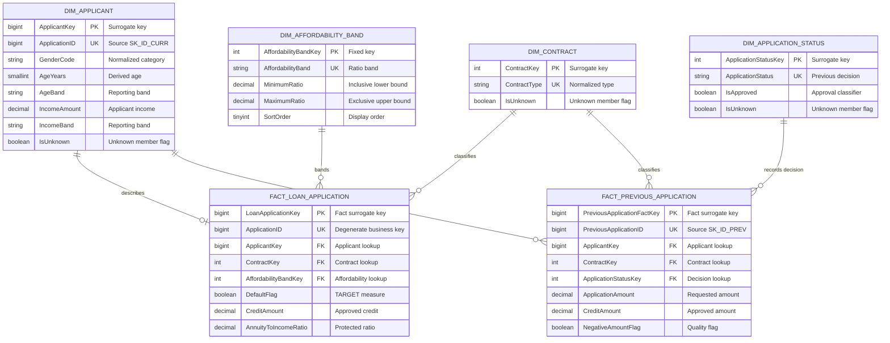
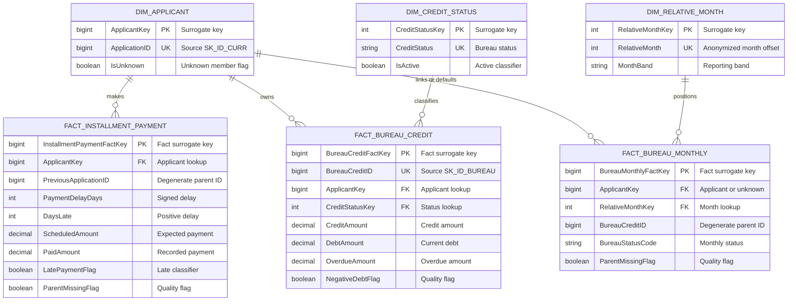
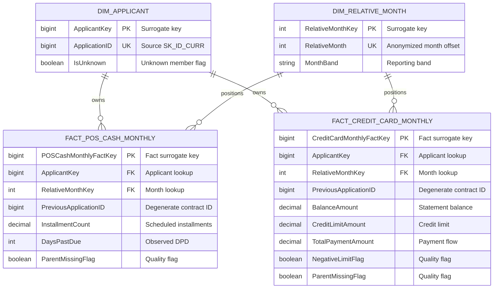

# DDS dimensional model — Home Credit BI

_Logical and physical design of the dimensional data store used by SQL Server and Power BI_

---

## 🎯 Modeling principles

- Declare one exact grain for every fact table before selecting measures
- Keep current applications and one-to-many credit histories in separate facts
- Reuse conformed dimensions for applicant, contract, status, and relative month
- Resolve missing lookups to explicit unknown members instead of dropping facts
- Preserve source business identifiers as degenerate keys where drill-through is required
- Calculate default KPIs only from `FactLoanApplication`

The source does not provide real calendar dates. `DimRelativeMonth` therefore represents anonymized month offsets and must not be presented as a conventional calendar dimension.

## 📊 Bus matrix

| Business process | Applicant | Contract | Application status | Credit status | Relative month | Affordability |
| --- | :---: | :---: | :---: | :---: | :---: | :---: |
| Current loan application | ✓ | ✓ |  |  |  | ✓ |
| Previous application | ✓ | ✓ | ✓ |  |  |  |
| Installment payment | ✓ |  |  |  |  |  |
| Bureau credit | ✓ |  |  | ✓ |  |  |
| Bureau monthly status | ✓/Unknown |  |  |  | ✓ |  |
| POS/cash monthly snapshot | ✓ |  |  |  | ✓ |  |
| Credit-card monthly snapshot | ✓ |  |  |  | ✓ |  |

## 🏗️ Current and previous application star

## 💳 Payment and bureau stars

`PreviousApplicationID` and `BureauCreditID` remain degenerate identifiers in child facts. The model deliberately avoids fact-to-fact relationships; Power BI filters facts through dimensions and uses the identifiers only for audit or drill-through.

## 📅 Monthly snapshot stars

## 📏 Fact grain and additivity

| Fact | Exact grain | Additive measures | Non-additive or semi-additive |
| --- | --- | --- | --- |
| `FactLoanApplication` | One labeled TRAIN application | Credit, annuity, goods price, income | Default rate, affordability ratios |
| `FactPreviousApplication` | One previous application linked to a TRAIN applicant | Requested, credit, down-payment amounts | Approval rate |
| `FactInstallmentPayment` | One source payment row linked to a TRAIN applicant | Scheduled, paid, variance amounts | Late-payment rate, average delay |
| `FactBureauCredit` | One bureau credit linked to a TRAIN applicant | Credit, debt, overdue amounts | Active-credit rate |
| `FactBureauMonthlySnapshot` | One source bureau-month row in DDS scope | Row count | Status distribution over time |
| `FactPOSCashMonthly` | One source POS/cash contract-month row | Row count | Balance-like snapshot values |
| `FactCreditCardMonthly` | One source credit-card contract-month row | Payments within a month | Balance, limit, utilization snapshots |

Monthly balances and debt-like values must not be summed across relative months as though they were transaction flows. Ratios must be recalculated from their numerators and denominators or aggregated with an explicitly approved method.

## 🔑 Key and relationship policy

| Rule | Implementation |
| --- | --- |
| Dimension primary key | Integer or bigint surrogate key |
| Source identity | Retained as a business or degenerate key |
| Relationship direction | One-way dimension-to-fact in Power BI |
| Fact-to-fact relationship | Prohibited |
| Missing category lookup | Resolve to the dimension's unknown member |
| Missing source parent | Preserve the fact and set `ParentMissingFlag = 1` |
| Batch lineage | Every mutable dimension and fact references `ctl.ETLBatch` |
| Duplicate protection | Unique constraint or batch-plus-source-row grain check |

## 🔄 History strategy

The current implementation uses a reproducible full-load strategy. Dimensions represent the latest normalized source state within a canonical batch; they do not implement Slowly Changing Dimension Type 2 because the dataset is a static competition snapshot without reliable business-effective dates.

If incremental sources become available, the next design step is to add `ValidFromUtc`, `ValidToUtc`, and `IsCurrent` to historized dimensions, define change-detection hashes, and document late-arriving-dimension handling. These features are intentionally outside the current MVP rather than silently simulated.

## ⚠️ Interpretation guardrails

- `DefaultRate`, approval rate, and late-payment rate are ratios and cannot be added across groups
- `ExternalScoreAverage` is a descriptive feature, not a calibrated probability of default
- Negative financial values remain in the warehouse with quality flags because they may represent adjustments
- Unknown members preserve population counts but must be visible in data-quality reporting
- Default-risk visuals must use `FactLoanApplication`, never a joined history table

For exact SQL types, nullability, indexes, constraints, and deployed foreign keys, use `sql/03_dds/030_create_dds_tables.sql` and run `sql/06_analytics/062_data_dictionary_query.sql` after deployment.
