# Project status — Home Credit BI

_Cập nhật: 29/10/2026 — Nhóm 8_

---

## 📊 Đánh giá sau khi đối chiếu đề bài

Thiết kế dữ liệu và baseline hiện tại vẫn có giá trị, nhưng kiến trúc SSIS cũ không đáp ứng toolchain bắt buộc. Project đã chuyển hướng sang `Mage.ai → SQL Server STG → dbt → SQL Server marts → Power BI + GenAI`.

| Góc đo | Tiến độ ước tính | Diễn giải |
| --- | ---: | --- |
| Phân tích local và KPI oracle | **100%** | 7 business files, 58.441.149 rows, KPI invariants PASS |
| Thiết kế dữ liệu tái sử dụng | **90%** | Grain, cleaning rules, STG/NDS/DDS, KPI và test contracts đã có |
| Required-stack source artifacts | **45%** | Mage spec, dbt application MVP và GenAI contract đã có; history chưa migrate |
| Required-stack runtime | **0% verified** | Chưa có Mage/dbt/SQL Server/Power BI/GenAI run end-to-end |
| Report/demo | **65%** | Nội dung data/model tốt; kiến trúc, evidence và dashboard cần cập nhật |

Các tỷ lệ là ước tính quản trị dự án, không phải điểm số môn học. `0% verified` không có nghĩa là chưa có mã nguồn; nó có nghĩa là chưa có execution evidence của toolchain bắt buộc.

## ✅ Phần giữ lại được

- Manifest SHA-256, profiling và full-data quality scan
- 307.511 labeled applications, 24.825 defaults và default rate 8,0729%
- Source-to-target mapping và cleaning rules có lineage
- Control, audit và source-aligned staging DDL trên SQL Server
- Grain, bus matrix, dimensions, facts và canonical KPI definitions
- SQL validators, semantic views và independent Python KPI oracle
- Power BI model/DAX specification
- GitHub Actions và static artifact validator

## 🔄 Phần đã chuyển đổi

- SSIS không còn là orchestrator chính; Mage chịu trách nhiệm ingestion, trigger, retry và logging
- dbt chịu trách nhiệm cleaning, transformations, tests, documentation và lineage
- Đã thêm dbt application vertical slice từ `stg.Application` tới `FactLoanApplicationMVP`
- Đã thêm Mage pipeline specification và mẫu cấu hình MSSQL không chứa credential
- Đã thêm GenAI input/output contract và JSON schema cho grounded KPI narrative
- Validator và README đã chuyển sang kiểm tra required-stack artifacts

## 🧭 Kiến trúc mục tiêu

```mermaid
flowchart LR
    accTitle: Required Stack Migration
    accDescr: Existing profiling and SQL assets feed a required architecture where Mage orchestrates ingestion, dbt transforms and tests data in SQL Server, and verified marts serve Power BI and a grounded generative AI component.

    raw(["Raw CSV"]) --> mage["Mage ingestion"]
    mage --> stg[("SQL Server STG")]
    stg --> dbt["dbt models and tests"]
    dbt --> marts[("SQL Server marts")]
    marts --> pbi(["Power BI"])
    marts --> ai["Grounded GenAI"]
    ai --> pbi

    classDef input fill:#ede9fe,stroke:#7c3aed,stroke-width:2px,color:#3b0764
    classDef process fill:#dbeafe,stroke:#2563eb,stroke-width:2px,color:#1e3a5f
    classDef data fill:#fef9c3,stroke:#ca8a04,stroke-width:2px,color:#713f12
    classDef output fill:#dcfce7,stroke:#16a34a,stroke-width:2px,color:#14532d

    class raw input
    class mage,dbt,ai process
    class stg,marts data
    class pbi output
```

## 👥 Phân công chính thức

Bảng timeline 4 × 12 có cấu trúc quản trị tốt: mỗi task có dependency, deliverable, acceptance và reviewer. Nhóm giữ cấu trúc đó nhưng thay toàn bộ task SSIS bằng Mage/dbt và ưu tiên lại từ ngày 29/10.

| Thành viên | Vai trò chính | Deliverable bắt buộc | Reviewer |
| --- | --- | --- | --- |
| Nguyễn Thế Hiển | Data analyst/BI analyst, DQ, KPI oracle, documentation, coordination | Mapping, test oracle, report, acceptance matrix | Nguyễn Quốc Bảo |
| Nguyễn Trường Duy | Data engineer — Mage ingestion/orchestration | Mage pipeline, reject path, shared `BatchID`, logs, rerun | Nguyễn Văn Hộp |
| Nguyễn Văn Hộp | Analytics engineer — dbt/SQL Server | dbt models/tests/docs, SQL deploy, reconciliation, performance | Nguyễn Trường Duy |
| Nguyễn Quốc Bảo | BI/AI engineer | PBIX, SQL–DAX matrix, grounded GenAI demo, slides/video | Nguyễn Thế Hiển |

## 🚦 Dependency gates

| Gate | Owner | Điều kiện PASS |
| --- | --- | --- |
| G0 — Required stack | Hiển | README, architecture, ownership và backlog không còn coi SSIS là core |
| G1 — Environment | Duy/Hộp | Mage Docker, dbt, ODBC và SQL Server `SELECT 1` hoạt động |
| G2 — Ingestion | Duy | TRAIN/TEST vào STG với `BatchID`, accepted/rejected counts và log |
| G3 — dbt MVP | Hộp | `dbt build` PASS; lineage có source/staging/intermediate/mart |
| G4 — KPI reconciliation | Hộp/Hiển | 307.511 applications, 24.825 defaults, 8,0729% khớp oracle |
| G5 — Power BI | Bảo | DAX bằng SQL dưới cùng filter; ít nhất hai trang demo hoạt động |
| G6 — GenAI | Bảo/Hiển | Chỉ dùng aggregate KPI, JSON hợp lệ, không bịa số/nhân quả |
| G7 — Rerun/final | Cả nhóm | Rerun không duplicate; report/demo có evidence từ cùng `BatchID` |

## ⏭️ Kế hoạch ưu tiên từ 29/10

### 29/10 — cứu kiến trúc và dựng vertical slice

- **Hiển:** khóa mapping application MVP, cập nhật kiến trúc/report và chuẩn bị KPI oracle
- **Duy:** cài Docker/Mage, kết nối SQL Server, tạo pipeline skeleton và block `start_batch`
- **Hộp:** deploy SQL, chạy `dbt debug`, sửa dbt MVP tới khi compile được
- **Bảo:** cài Power BI, tạo wireframe và GenAI mock từ KPI JSON nhưng gắn nhãn `MOCK`

### 30/10 — trình bày tiến độ trung thực

- Ưu tiên demo một vertical slice chạy thật: TRAIN/TEST sample → Mage → STG → dbt → SQL result
- Nếu runtime chưa xong, trình bày rõ `Implemented / Verified / Blocked`; không dùng mock làm bằng chứng runtime
- Power BI và GenAI được demo bằng data đã verified hoặc ghi rõ mock scope

### 31/10–07/11 — hoàn thiện mini project

1. Migrate six remaining business sources to dbt
2. Hoàn thiện DDS/star marts và full KPI tests
3. Build Power BI pages and SQL–DAX reconciliation
4. Add grounded GenAI Python block and failure fallback
5. Run full/incremental/rerun tests and capture performance
6. Update report, slides, video, and final submission package

## ⚠️ Rủi ro đang mở

- `dbt-sqlserver` là community adapter; phải khóa version sau proof-of-connection
- Mage–dbt integration cần Docker hoặc Mage Pro; nhóm chọn Docker OSS
- Full history tables lớn, nên application vertical slice phải PASS trước khi mở rộng
- Power BI và GenAI không được đọc trực tiếp dữ liệu chưa qua dbt tests
- SSIS artifacts cũ chỉ còn giá trị tham khảo lịch sử và không được nộp thay Mage/dbt
