# Mage orchestration specification

_Required pipeline replacing SSIS as the project orchestrator_

---

## Architecture decision

Mage owns ingestion, orchestration, retries, scheduling, and run evidence. dbt owns deterministic SQL transformations, tests, lineage, and documentation. SQL Server stores STG and analytical objects; Power BI reads only verified marts. This separation matches Mage's documented ability to orchestrate dbt models and fail a pipeline when dbt tests fail.[^1]

Mage's dbt integration must run in Docker or Mage Pro. The course implementation therefore uses Mage OSS in Docker and `dbt-sqlserver`; it does not require Mage Pro.[^1][^2]

```mermaid
flowchart LR
    accTitle: Required Home Credit Pipeline
    accDescr: Mage ingests Home Credit files into SQL Server staging, orchestrates dbt transformations and tests, then publishes verified marts to Power BI and a grounded generative AI summary.

    csv(["Home Credit CSV"]) --> mage["Mage ingestion"]
    mage --> stg[("SQL Server STG")]
    stg --> dbt["dbt build and tests"]
    dbt --> marts[("SQL Server marts")]
    marts --> pbi(["Power BI"])
    marts --> genai["Grounded GenAI"]
    genai --> pbi

    classDef input fill:#ede9fe,stroke:#7c3aed,stroke-width:2px,color:#3b0764
    classDef process fill:#dbeafe,stroke:#2563eb,stroke-width:2px,color:#1e3a5f
    classDef data fill:#fef9c3,stroke:#ca8a04,stroke-width:2px,color:#713f12
    classDef output fill:#dcfce7,stroke:#16a34a,stroke-width:2px,color:#14532d

    class csv input
    class mage,dbt,genai process
    class stg,marts data
    class pbi output
```

## MVP pipeline blocks

| Order | Block | Responsibility | Failure rule |
| ---: | --- | --- | --- |
| 1 | `start_batch` | Create one `ctl.ETLBatch` and return `BatchID` | Stop if the batch cannot be created |
| 2 | `load_application_train` | Load TRAIN CSV to `stg.Application` with lineage | Reject malformed rows; preserve error details |
| 3 | `load_application_test` | Load TEST CSV with `TARGET = NULL` | Reject invalid split or key |
| 4 | `validate_staging` | Run staging counts and domain checks | Stop on any `FAIL` |
| 5 | `dbt_build_mvp` | Run dbt with the same `BatchID` | Stop when a model or test fails |
| 6 | `reconcile_kpis` | Compare SQL results with the local oracle | Stop on population or numerator mismatch |
| 7 | `generate_insight` | Send aggregate KPI JSON to the selected LLM | Fall back to a deterministic message on API failure |
| 8 | `finish_batch` | Record status, counts, duration, and error | Mark `SUCCEEDED` only after all gates pass |

## Connection setup

Copy `io_config.yaml.example` to the Mage project as `io_config.yaml`, set credentials through environment variables, and never commit the populated file. Mage documents the `MSSQL_*` keys and includes ODBC Driver 18 in its Docker image.[^3]

The initial proof should load only `application_train.csv` and `application_test.csv`. After that vertical slice passes, extend the same pattern to previous application, bureau, bureau balance, installments, POS/cash, and credit-card sources.

## Required evidence

- Mage pipeline graph and trigger configuration
- run log showing one shared `BatchID`
- accepted and rejected row counts per file
- dbt run/test summary and lineage screenshot
- SQL population/KPI result grid
- rerun with no duplicated business keys
- GenAI input JSON and output with no row-level personal data

[^1]: Mage AI. "Use dbt with Mage." https://docs.mage.ai/guides/dbt/overview

[^2]: Mage AI. "Make dbt magical." https://docs.mage.ai/guides/dbt/setup-dbt

[^3]: Mage AI. "Microsoft SQL Server." https://docs.mage.ai/integrations/databases/MicrosoftSQLServer

